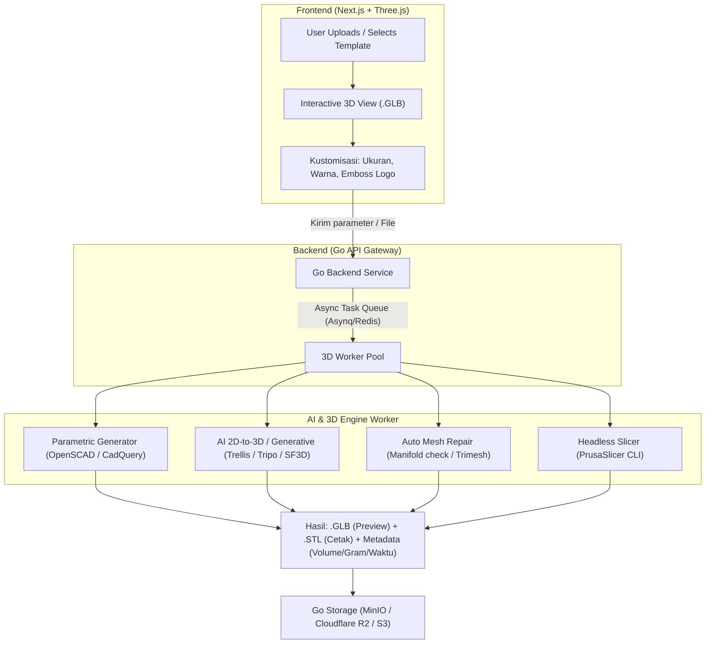

# 🧩 Arsitektur Sistem 3D & AI Pipeline
## Panduan Teknis Pemrosesan Model 3D & Integrasi AI

---

## 1. Bagaimana Sistem Model 3D Bekerja?

Di industri 3D printing web modern, kita memisahkan model 3D menjadi **2 kegunaan utama**:
1. **Web Viewing / Customizer (Frontend Three.js / React Three Fiber)** -> Menggunakan format **`GLB` / `glTF`**.
   * Karakteristik: Ringan, mendukung material PBR (tekstur mengkilap, matte, metallic), cepat di-render di browser HP/laptop pelanggan.
2. **Manufacturing & Slicing (Backend Slicer Engine)** -> Menggunakan format **`STL` / `OBJ` / `STEP`**.
   * Karakteristik: Geometri presisi matematis tanpa tekstur warna (mesh segitiga solid), digunakan oleh mesin slicer untuk membuat jalur cetak (*G-code*).



---

## 2. Tipe Model 3D yang Disediakan untuk UMKM

Untuk UMKM, ada 3 pendekatan model 3D:

### A. Parametric Packaging Templates (Pendekatan Utama & Cepat)
* **Konsep**: UMKM tidak perlu mahir 3D. Disediakan template kemasan standar (misal: *Box Kemasan Sabun*, *Tutup Botol*, *Standing Pouch Clip*, *Wadah Jar Kosmetik*, *Packaging Sleeve*).
* **Kustomisasi**: UMKM cukup memasukkan slider Panjang ($P$), Lebar ($L$), Tinggi ($T$), ketebalan dinding, dan upload file logo PNG/SVG untuk di-emboss (timbul) / deboss (tenggelam) pada kemasan.
* **Engine**: Python/Go worker memanggil **CadQuery** atau **OpenSCAD CLI** untuk merender file STL baru secara real-time.

### B. AI 2D-to-3D Generator (Untuk Merchandise / Maskot / Logo 3D)
* **Konsep**: UMKM mengunggah gambar produk, maskot, atau foto 2D.
* **AI Model Options**:
  1. *Stable Fast 3D (SF3D)* / *Trellis* / *TripoSR*: Menghasilkan mesh 3D dari 1 gambar dalam waktu 1-5 detik.
  2. *Relief Extruder*: Mengubah logo vektor (SVG) menjadi plakat 3D / keychain dengan depth mapping.

### C. Direct Custom 3D Upload (Untuk Kreator / UMKM yang sudah punya file)
* Upload file `.stl` / `.obj`.
* Sistem otomatis mengecek ketebalan minimum dinding (misal minimal 1.2 mm untuk cetak FDM).

---

## 3. Pipeline Slicing & Kalkulasi Harga Instan (Instant Pricing)

### 3.1 Mengapa Perlu Slicing di Backend?
Mesin 3D printer memerlukan instruksi baris per baris (*G-code*). Melalui slicing, kita bisa mengetahui secara presisi:
1. **Filament Length & Weight**: Berapa gram filamen yang dibutuhkan (termasuk infill dan support).
2. **Print Duration**: Berapa jam dan menit waktu pengerjaan mesin.
3. **Layer Count**: Jumlah lapisan cetak.

### 3.2 Headless Slicer Setup
Backend Go menjalankan background worker yang memanggil CLI Slicer:
```bash
# Contoh eksekusi Headless PrusaSlicer via Go Command / Docker
prusa-slicer-cli --export-gcode --layer-height=0.2 --fill-density=20% \
  --load-config=/etc/slicer/ender3_v3_pla.ini model.stl --output=output.gcode
```
Dari metadata output G-code, Go mengekstrak:
* `filament used [g] = 42.50`
* `estimated printing time (normal mode) = 2h 15m 30s`

---

## 4. Format Penyimpanan & Arsitektur Storage

File disimpan pada Object Storage (S3 / MinIO / Cloudflare R2) dengan struktur:
```text
bucket-kemasan3d/
├── tenants/
│   └── {tenant_id}/
│       ├── brand_assets/ (logo, favicon, banner)
│       ├── templates/ (preset kemasan)
│       └── orders/
│           └── {order_id}/
│               ├── original_upload.png / .stl
│               ├── preview_model.glb
│               ├── production_model.stl
│               └── sliced_output.gcode
```

---

## 5. Rekomendasi Stack AI & 3D Worker

| Komponen | Pilihan Rekomendasi | Alasan |
| :--- | :--- | :--- |
| **API Gateway & Core SaaS** | **Go (Golang) + Gin / Fiber / Chi** | Super cepat, konsumsi memory rendah, concurrency tinggi untuk ratusan tenant. |
| **Task Queue / Worker** | **Asynq (Go + Redis)** | Background queue untuk proses slicing & AI callback yang butuh waktu 3-15 detik. |
| **3D Slicer Engine** | **PrusaSlicer CLI / CuraEngine** | Standar industri, akurat, gratis, dan mendukung export metadata kalkulasi. |
| **Mesh Utility & Repair** | **PyMeshFix / Trimesh / Open3D** | Memastikan STL manifold (tidak ada bolong/glitch) sebelum masuk mesin cetak. |
| **Parametric CAD Engine** | **CadQuery (Python) / OpenSCAD** | Menghasilkan STL kemasan custom ukuran secara deterministik. |
| **AI 2D/Text to 3D** | **Tripo API / Trellis / SF3D** | Integrasi microservice Python atau SaaS API GPU untuk generate 3D cepat. |
| **Frontend 3D Visualizer** | **Next.js + Three.js / @react-three/fiber** | User bisa memutar 3D, ubah warna, dan lihat preview realtime di browser. |
