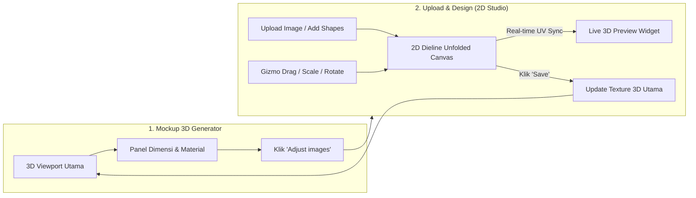

# Pacdora-Style 2D Dieline & 3D Live Sync Architecture

## 1. Overview
Sistem editor kemasan 3D mengadopsi standar industri **Pacdora**:
1. **Mode 1: Mockup Generator (3D View Utama)**
   - Fokus pada visualisasi fotorealistik 3D kemasan.
   - Panel kiri mengelola ukuran parametrik (Panjang $\times$ Lebar $\times$ Tinggi dalam mm), tebal dinding, material (*corrugated board, matte, glossy, kraft*), dan kartu preview jaring-jaring 2D.
   - Tombol aksi **"Adjust images"** / **"2D Design"** untuk membuka studio desain 2D.

2. **Mode 2: Upload & Design (2D Dieline Editor + Live 3D Sync Widget)**
   - Kanvas utama di tengah: **Jaring-jaring Lipatan Karton 2D (*Unfolded Dieline*)** lengkap dengan panel dinding (*Front, Right, Back, Left*), tutup atas (*Top Flap*), tutup bawah (*Bottom Flap*), *Dust Flaps*, dan lidah lem (*Glue Tab*).
   - Penempatan elemen desain (gambar upload JPG/PNG/SVG, shape geometris, badge, teks) dilakukan langsung pada bidang datar 2D dengan *bounding box gizmo* (geser, putar, perbesar).
   - Panel kanan: **Live 3D Preview Widget** yang terhubung secara instan (*real-time texture synchronizer*). Setiap perubahan posisi/skala pada bidang 2D langsung terproyeksikan secara mulus pada model 3D di samping kanan.
   - Navigasi cepat: Tombol **"✕"** atau **"Save"** untuk kembali ke tampilan 3D utama.

---

## 2. Diagram Alur Sistem (Mermaid)

---

## 3. Struktur Komponen Frontend
- `frontend/src/components/2d/DielineCanvas.tsx`: Render jaring-jaring kardus unfolded 2D, garis potong (*cut lines*), garis lipat (*crease lines*), dimensi mm, pola material fisik (kraft paper grain, corrugated flute lines, gold/silver foil gradients), dan manipulasi objek di atas panel.
- `frontend/src/components/3d/PackagingCanvas.tsx`: Canvas 3D Three.js / React Three Fiber dengan `MeshPhysicalMaterial`, IBL studio reflections (`Environment preset="city"`), procedural material surface synthesis (kraft noise/fibers, corrugated flutes, metallic brushed gradients, ultra-glossy clearcoat), dan continuous 360° texture mapping.
- `frontend/src/app/page.tsx`: Pengatur state 2-Mode (Mockup Generator $\leftrightarrow$ 2D Dieline Studio), katalog material fisik (Corrugated Cardboard, Brown Kraft, Matte Art, Glossy UV, Metallic Gold Foil, Metallic Silver Foil, Black Matte), dan sinkronisasi data objek/tekstur.

---

## 4. Sistem Material Kemasan Fisik
| Material Preset | Finish Shader | Texture Type | Karakteristik Visual & Fisik |
|---|---|---|---|
| **Corrugated Cardboard** | `kraft` | `corrugated` | Cokelat karton dengan tekstur serat kertas organik dan garis gelombang (*flutes*), `roughness: 0.90` |
| **Brown Kraft Paper** | `kraft` | `kraft` | Kertas kraft cokelat natural dengan bintik serat mikro, `roughness: 0.88` |
| **Matte Art Paper** | `matte` | `matte` | Putih bersih halus bebas silau (doff diffuse), `roughness: 0.65` |
| **Glossy Coated UV** | `glossy` | `glossy` | Putih mengkilap dengan pantulan specular tajam dan lapisan `clearcoat: 1.0` |
| **Metallic Gold Foil** | `metallic` | `gold_foil` | Hot stamping foil emas mewah dengan pantulan lingkungan (`metalness: 0.88`, `roughness: 0.15`) |
| **Metallic Silver Foil** | `metallic` | `silver_foil` | Foil perak chrome dengan kilau logam mengkilap (`metalness: 0.88`, `roughness: 0.15`) |
| **Black Matte Soft-Touch** | `matte` | `matte` | Hitam doff premium dengan tekstur lembut |
