# 📄 Product Requirement Document (PRD)
## Platform SaaS 3D Printing & Packaging Berbasis AI untuk UMKM

---

## 1. Executive Summary & Visi Produk
Platform ini adalah solusi **Multi-tenant SaaS 3D Printing & Custom Packaging** yang dirancang khusus untuk membantu UMKM (Usaha Mikro, Kecil, dan Menengah) mendapatkan kemasan kustom, prototipe produk, dan merchandise fisik 3D secara on-demand dengan bantuan kecerdasan buatan (AI).

Platform menyediakan:
1. **Storefront Kustom per UMKM**: Setiap tenant/UMKM dapat memiliki custom domain (misal: `toko.umkmbrand.com`) atau subdomain (`brand.kemasan3d.id`).
2. **AI-Assisted 3D Generator & Customizer**: Konversi deskripsi teks atau logo/gambar 2D menjadi model 3D cetak siap pakai (kemasan botol, box, embos logo, wadah custom).
3. **Instant Slicing & Pricing Engine**: Kalkulasi otomatis estimasi gramatur filamen/resin, waktu cetak, dan harga instan berdasarkan geometri 3D.
4. **Order & Production Hub**: Manajemen antrian mesin cetak 3D untuk UMKM/produsen.

---

## 2. Arsitektur Multi-Tenancy (Shared Database, Tenant Isolation)

### 2.1 Konsep Multi-Tenancy
* **Model Database**: **Shared Database, Shared Schema** dengan isolasi kolom `tenant_id` pada setiap tabel relasional.
* **Domain Routing**:
  * **Custom Domain Mapping**: Pengenalan tenant melalui header HTTP `Host` (contoh: `store.kopinusantara.id` -> `tenant_id: "uuid-kopinusantara"`).
  * **Subdomain Mapping**: `*.kemasan3d.id` -> resolved via DNS wildcard + reverse proxy.
  * **Tenant Middleware (Go)**: Middleware otomatis mengekstrak host, query DB/cache (Redis), lalu menyuntikkan `TenantContext` ke dalam request Go `context.Context`.

---

## 3. Fitur Utama (Core Modules)

### 3.1 Tenant & Storefront Management
* Onboarding tenant (UMKM).
* Pengaturan custom domain, branding (logo, warna, banner), dan konfigurasi harga profit margin.
* Integrasi payment gateway (Midtrans / Xendit).

### 3.2 AI 3D Packaging & Customizer Engine
* **2D to 3D Relief/Emboss**: Upload logo UMKM -> Otomatis diekstrusi ke model kemasan standar (toples, box, botol, sleeve).
* **Text/Prompt to 3D Asset**: Pembuatan mock-up bentuk baru menggunakan model AI 3D generative (Trellis / Tripo / Shap-E / Stable Fast 3D).
* **Mesh Auto-Repair**: Validasi apakah model 3D *watertight / manifold* (bebas lubang/non-manifold vertices).

### 3.3 Instant Slicer & Cost Estimator
* Pengguna upload file `.stl`, `.obj`, `.step`, atau `.glb`.
* Background worker menjalankan headless slicer CLI (misal: PrusaSlicer-CLI / CuraEngine).
* Output: Volume ($cm^3$), Berat ($gram$), Waktu cetak ($menit$), Kebutuhan support.
* Formula Harga Dinamis:
  $$\text{Harga} = (\text{Berat} \times \text{Harga Material/g}) + (\text{Waktu Cetak} \times \text{Tarif Mesin/jam}) + \text{Margin Tenant} + \text{Packaging Fee}$$

### 3.4 Order, Checkout & Farm Production Queue
* Pelanggan UMKM memilih material (PLA, PETG, Resin, ABS, TPU), warna, infill density, dan kuantitas.
* Antrian produksi (Print Farm status: *Queued*, *Printing*, *Post-Processing*, *Shipped*).

---

## 4. User Persona & User Flow

```mermaid
flowchart LR
    A["Customer / UMKM Client"] -->|"Akses Custom Domain"| B["Tenant Storefront"]
    B -->|"Upload Logo / Model / AI Prompt"| C["3D Web Viewer & AI Generator"]
    C -->|"Kalkulasi Otomatis"| D["Instant Cost & Slicer Engine"]
    D -->|"Checkout & Payment"| E["Midtrans / Xendit"]
    E -->|"Order Masuk"| F["UMKM Admin Dashboard"]
    F -->|"Kirim G-code ke 3D Printer"| G["Print Farm / Warehouse"]
```

---

## 5. Roadmap Fase Pengembangan
* **Fase 1 (Backend Core & Tenant System)**: Go Clean Architecture, Database PostgreSQL multi-tenant, Tenant resolver middleware, Auth JWT, File Upload S3/MinIO.
* **Fase 2 (3D Slicing & Mesh Engine)**: Worker Go (Asynq) + Headless Slicer CLI, mesh volume calculation, pricing calculator.
* **Fase 3 (AI Generation Bridge)**: Integrasi API/Worker AI (Text-to-3D, Image-to-3D, Auto-emboss).
* **Fase 4 (Next.js Frontend & Three.js Canvas)**: Web Viewer 3D, Customizer canvas, Tenant dashboard, Storefront portal.
